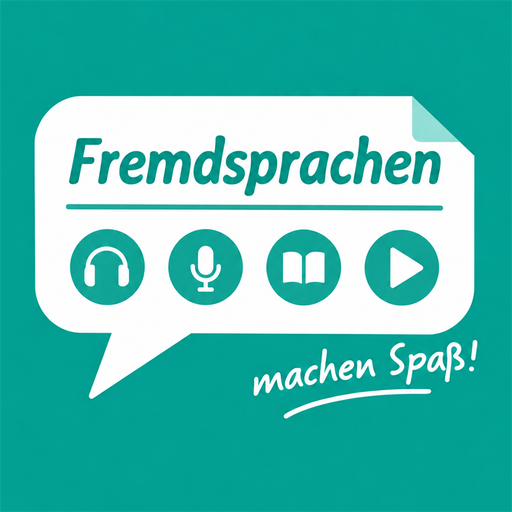

<div align="center">
  
  <h1>FmS — fms-app</h1>
  <p><strong>Fremdsprachen machen Spaß!</strong> — Foreign languages are fun.</p>
  <p>
    A local language lab: turn the material you already own into <strong>dictation, reading,
    speaking and vocabulary practice</strong> — on your machine, offline, no account, no per-minute
    bill.
  </p>
  <p>
    Built first for the German learner heading towards Goethe or TestDaF.
  </p>
  <p>
    <a href="https://github.com/wsva/fms-app/releases/latest"></a>
    <a href="https://github.com/wsva/fms-app/actions/workflows/build.yml"></a>
    
    
    <a href="LICENSE"></a>
  </p>
</div>

---

## What is this?

FmS is a **local-first language lab**. You bring the material you already own — a textbook's MP3s,
an audiobook, a podcast, a lecture recording, a chapter of prose — and it becomes practice. Five
modes share one dataset layer, and all five are core: **dictation** (type what you hear), **books**
(read, look up, understand), **read aloud** (speak and be scored), **cards** (review what you kept)
and **wiki** (the notes that tie it together). No upload, no per-minute bill, no account: the
models, the datasets and your progress live on the disk you already have.

**Dictation is where it started.** Import the files, a local speech-to-text model cuts them into
cue-level subtitles, and you train by typing what you hear, cue by cue, revealing the reference when
you are done.

**Between sessions it is a toolkit.** The same app recognises text in a screenshot, splits a raw
text into sentences, reads a PDF, speaks a sentence in a natural voice and keeps a searchable
wiki — the everyday jobs that earn it a permanent place on your machine.

**Who it's for:** the intermediate German learner — roughly B1 to C1 — working towards the
Goethe-Zertifikat or TestDaF, who wants to train on *real* speech (a novel read aloud, a news
podcast, a course's own drills) rather than the dozen canned clips that come with a textbook. The
method is not German-specific: it works for any language with a usable local STT model, and it is
the loop the old FSI and Peace Corps drill courses were built around.

**Why not something else?**
- **Anki** is a scheduler: it reviews cards you have already made and does not transcribe or cue
  audio.
- **LingQ** is reading-first — the text sits in front of you and you tap the words you don't know.
  FmS hides the text and asks you to produce it.
- **Language Reactor** runs on top of Netflix and YouTube, so the material has to live on those
  platforms, and the subtitles are given to you rather than being the thing you write.
- **Speechify** reads text aloud to you; FmS asks you to write down what you hear.

**Audio stays on the device**, and no model call is metered. The few features that do talk to the
network are listed under [Privacy](#privacy), and what you may safely import is covered under
[Bring your own content](#bring-your-own-content).

The app is a **Tauri v2** port of the web version at [wsva/fms](https://github.com/wsva/fms),
and ships for **Windows, Linux and macOS**, plus **Android and iOS** clients that practise a dataset
and sync it with a PC. Every target is built from this repository by
[GitHub Actions](.github/workflows/build.yml) on each `v*` tag.

## Features

**Five practice modes, all of them core** — each with its own dataset type, its own page, and the
same cross-device sync.

- **Dictation** — import what you own (`mp3`, `wav`, `m4a`/`m4b` (audiobooks), `ogg`, `flac`, `mp4`,
  `webm`), let on-device STT cut it into cues, then type what you hear: canvas waveform, cue cards,
  per-cue progress, large and focus modes, and a word-level hint that lights up the words you missed.
- **Books** — split a text into chapters and sentences, read along with per-sentence TTS, look words
  up in context, and build its understanding layer: explanations, simplifications, a chapter digest,
  an argument map, a glossary, and comprehension quizzes.
- **Read Aloud** — record a text and have it scored on accuracy, fluency and pronunciation against a
  reference clip you generate with Edge TTS or cut out of your own recording by alignment. Feedback
  comes from a local model or an attached agent.
- **Cards** — separate flashcard datasets with SM-2 review queues, FTS5 search, tags and a hint
  field, for the vocabulary you collect from your own material.
- **Wiki** — syncable Markdown trees with full-text search: notes, grammar references, transcripts
  and the links between them, editable on the phone as well as on the PC.

Cards, read-aloud passes and book quizzes all pay into one **XP ledger**.

**The layer they share**

- **One pipeline** — import → subtitles (STT) → waveforms → database, plus transcript alignment and
  book splitting: one click on the dataset page, or step by step on the **Workflow** page.
- **Local models** — Parakeet ONNX and Whisper GGML for speech, SaT for sentence splitting, Tesseract
  for OCR; downloaded, loaded and swapped from the Models page.
- **Sync** — pull a dataset from another FmS machine over the LAN or tailnet (phone ↔ PC, PC ↔ PC),
  with discovery, device pairing and snapshot progress.
- **Nothing is lost by accident** — a destructive action moves the dataset or file into the app
  trash, where you can restore it.

**Everyday tools — the reason it stays installed**

- **OCR** — drop in a screenshot, a photo of a page or a scanned exercise and get editable text: pick
  the languages, and the layout comes back as lines and paragraphs instead of a word dump. Words
  broken across a line break are joined when a downloaded Hunspell dictionary knows the result
  (`Sprach-` + `verarbeitung` → `Sprachverarbeitung`) and kept as printed when it does not; 15
  dictionaries are available, a shape rule covers the rest, and an optional LLM pass cleans up
  obvious errors. Screenshot and clipboard capture are built in.
- **Edge TTS** — speak any text in a natural voice, in every language the app needs, with no API key
  (the text itself goes to Microsoft's Edge endpoint; see [Privacy](#privacy)).
- **Split Text** — run the sentence-segmentation model on any pasted text and get clean sentences
  back.
- **PDF Reader** — read documents and handouts without leaving the app.
- **Simple Words** — mark the words you already know, so word generation and dictation helpers stop
  offering them.
- **Voice input** — tap the mic, or press `Ctrl+C` in a text field, and your speech is transcribed
  locally and inserted at the cursor.
- **Workspaces** — several learners or several projects, with separate settings, progress and
  datasets on one machine.

**Agents can drive the app.** The practice modes and the dataset pipeline are exposed as MCP tools,
so an attached agent can import, generate, audit, score and edit alongside you. The app publishes its
own agent manual, and a dock in the UI shows what an agent is doing while it works.

**LLM features, no chat window.** A language model is called from the features that need one —
chapter digests, word explanations in Books, comprehension quizzes, OCR clean-up, read-aloud text
normalization, and feedback on a take. Point it at a local Ollama, or at a cloud provider through the
goose SDK layer; for open-ended questions use your own model or an attached agent.

## Privacy

FmS is **local-first, not local-only**. Transcription, cuing, review scheduling, scoring and OCR all
run on-device; a handful of features need the network, and each one is something you switch on.
There is no telemetry, no analytics, no crash reporting, and no account is needed to use the app.

| What you do | Leaves the device? | What is sent |
|---|---|---|
| Import, STT subtitles, waveforms, cue database, alignment | **No** | — |
| Dictation, cards, review scheduling, search, XP, wiki | **No** | — |
| Voice input, read-aloud scoring, OCR, book splitting | **No** | — |
| LLM features with Ollama on `localhost` (OCR clean-up, word explanations, read-aloud normalization) | **No** | — |
| The same LLM features with a cloud provider (`openai`, `anthropic`, `groq`, `databricks`) | Yes — only if you configure a key | The prompt, and the text it asks about |
| Speaking text aloud: Books, Read Aloud, Understanding panel, TTS page | Yes | The text to be spoken → Microsoft Edge TTS |
| Dataset sync to another of your devices | To that device only | The dataset snapshot, over your LAN or tailnet |
| Website account, dataset registry, mirror | Yes — opt-in | Login plus the dataset metadata you publish to `lusworkshop.site` |
| Model download | Yes — opt-in | A file request to `huggingface.co` or `blob.handy.computer` |
| Release/update check (Settings → About) | Yes | A request to `api.github.com`; no identifiers beyond the request itself |

**Audio never leaves the device.** Every speech-to-text path is on-device (ONNX and GGML models
downloaded once into your model directory; see the [manual](docs/manual/models.md)). Only *text* can
leave, and only via the rows above that say so.

The embedded MCP/HTTP server (port `35711`) is how an agent talks to the app. Loopback peers and
Tailscale addresses (`100.64.0.0/10`) are trusted without credentials — with a `Host`-header check so
a web page cannot reach it by pointing a public name at `127.0.0.1` — and every other peer must
present a paired device's Ed25519 signature; unpaired peers can read only `/api/v1/status`,
`/api/v1/cluster`, `/api/v1/pair/*` and the agent manual. The socket does listen on all interfaces,
because that is how a paired phone syncs, and a UDP beacon on `35712` advertises the machine on your
LAN so devices can find each other. Whatever you let a connected agent read does go to that agent —
that is the point of attaching one — so attach an agent on your own machine if you want that traffic
to stay there.

API keys and the website login token are stored in this app's own settings and auth files inside
your workspace, are only ever sent to the provider you chose, and are redacted (`***`) when a tool
reads settings back.

### Edge TTS is an unofficial dependency

Speech synthesis uses the endpoint behind Edge's *Read Aloud*. It needs no API key, which is why it
is free and covers every language the app needs — but it is **not a public Microsoft API**: it can
change or stop working without notice, and it is governed by Microsoft's terms, not this project's.
It has broken once already (the older client's `Sec-MS-GEC` token began returning `403`, fixed by a
newer token version in `edge-tts-rust` 0.1.7). Treat speech synthesis as best-effort: synthesized
audio is cached on disk, so anything already spoken keeps playing offline.

**Planned:** a local TTS engine (Piper-class) as a fallback, which would let Books and Read Aloud
run with the network switched off. Until then, TTS is the one feature that needs a connection.

## Bring your own content

FmS ships **no datasets** — no audio, no subtitles, no transcripts. It is a player and a drill tool:
the material you feed it is content you bring, and its licence is yours to respect, the same way a
video player has no opinion about the film you open.

- **Import what you may use.** Buying an audiobook or a textbook gives you a licence to listen and
  read, not to transcribe, redistribute or publish. Removing DRM is illegal in most jurisdictions
  whatever you do with the file afterwards, so don't feed FmS a DRM-stripped file.
- **Practising is not publishing.** Running STT, building cues and drilling on your own machine is
  personal use. *Upload* and then *Publish* on the Datasets Sync page is redistribution: the dataset
  goes to the website, the upload dialog's visibility decides who can pull it (`private` by default,
  `shared` for subscribed accounts, `public` for everyone), and every audio file, subtitle, cue and
  transcript in it has to be licensed for that. *Withdraw* takes a published version down but keeps
  the stored bytes, so it is not an undo for a licensing mistake — check before you publish.
- **Credit where a licence asks for it.** CC BY and CC BY-SA sources need attribution (and
  share-alike on derivatives); public-domain sources don't, though naming the source costs nothing.

### Sources you can legally import

None of these are bundled with the app — they are simply places whose terms allow you to download
the material and practise with it. Check the licence on the individual item, not just the front
page, and check it for the country you are in.

| Source | What it gives you | Terms |
|---|---|---|
| [LibriVox](https://librivox.org) | Volunteer audiobooks in many languages — German, French, Spanish and English classics included | Public domain in the USA; verify the author's status in your own country |
| [Project Gutenberg](https://www.gutenberg.org) | The text to pair with LibriVox audio, for transcript alignment | Public-domain texts under US law; the Gutenberg header is a trademark licence you can strip |
| [FSI & Peace Corps courses](https://www.fsi-language-courses.org/) ([mirror](https://yojik.eu)) | Full courses: textbook PDFs plus hours of drill audio, dozens of languages including German | US government works, public domain |
| [VOA Learning English](https://learningenglish.voanews.com) | Slow, scripted news with transcripts, graded by level | Public domain with credit to VOA — except AP/Reuters/AFP material, which is not |
| [Wikimedia Commons](https://commons.wikimedia.org) | Spoken Wikipedia articles, pronunciation clips | Per file: CC BY, CC BY-SA or public domain |
| [Lingua Libre](https://lingualibre.org) | Native-speaker recordings of words and phrases | CC BY-SA 4.0 |
| [Tatoeba](https://tatoeba.org) | Sentence pairs in 300+ languages, good for card decks | Sentences CC BY 2.0 FR; each recording carries its speaker's own licence |
| [Internet Archive](https://archive.org) | Old radio, government and public-domain recordings, audiobooks | Mixed — filter to public domain or CC before importing |

## Download

Grab a prebuilt installer from the [latest release](https://github.com/wsva/fms-app/releases/latest):

| Platform | Artifacts | Notes |
|----------|-----------|-------|
| Windows  | `.exe` (NSIS) | x64 |
| Linux    | `.AppImage`, `.deb`, `.rpm` | x64 |
| macOS    | `.dmg` | Apple Silicon only, macOS 11+, unsigned |
| Android  | `.apk` | arm64 |
| iOS      | `.ipa` | arm64, unsigned — re-sign it before it will install |

Each asset is named `FmS_<platform>_<arch>_<tag>.<ext>` — `FmS_windows_x64_v0.1.1.exe`,
`FmS_linux_amd64_v0.1.1.deb`, `FmS_macos_arm64_v0.1.1.dmg` — so the release tag is the only version
in the name.

### Updates

The app updates itself from **Settings → About**: it reports whether a newer release exists, and
*Download & install* fetches it, verifies the signature and restarts into it. Nothing installs on its
own, and nothing is checked at startup — the check runs when you open that panel.

| Platform | In-app update |
|----------|---------------|
| Windows (NSIS `.exe`) | Yes |
| Linux (AppImage) | Yes — only when run from the AppImage; a `.deb`/`.rpm` install shows a link to the release instead |
| macOS, Android, iOS | No — re-download and reinstall |

Releases up to v0.1.13 shipped an `.msi` as well; that build is gone. **If you installed from an
`.msi`, uninstall that copy once** and install the current `.exe` — the two are separate installs,
and only the NSIS one can update itself.

Installers are signed with a minisign key whose public half lives in `tauri.conf.json`, so a release
whose signature does not verify is refused rather than installed. A bad release is pulled by deleting
`latest.json` from it — clients then report no update and install nothing.

### Apple builds

**Apple Silicon only.** The STT and desktop feature sets link ONNX Runtime through `ort-sys`, whose
prebuilt binaries cover `aarch64-apple-darwin` and `aarch64-apple-ios` but not Intel Macs, so there
is no `x86_64` build to download. macOS 11 (Big Sur) is the floor.

**The macOS bundle is unsigned**, so Gatekeeper blocks the first launch of the downloaded app.
Either right-click → *Open*, or clear the quarantine flag once:

```bash
xattr -dr com.apple.quarantine /Applications/FmS.app
```

**The iOS package needs re-signing.** CI holds no Apple Developer certificate, so the `.ipa` is
archived with signing disabled and published as `FmS_ios_arm64_<tag>-unsigned.ipa`. Re-sign it with
a free Apple ID (Sideloadly, AltStore) or a paid one (Xcode), then sideload.

**The phone builds are clients, not PC replacements.** A phone practises a dataset and syncs it with
a PC. What *builds* one — subtitle and waveform generation, transcript alignment, book splitting —
and the PC-hosted extras (embedded HTTP/MCP server, OCR, screenshot capture, the Goose agent bridge)
are desktop-only.

### Platform notes

- **OCR needs Tesseract on macOS and Linux.** The app runs `tesseract` from `PATH`
  (`brew install tesseract` / `apt install tesseract-ocr`); only the usual Windows install
  locations are probed by the app itself.
- **Screen capture on macOS** asks for *Screen Recording* permission on first use and captures the
  primary monitor — the drag-out-a-region overlay is Windows-only.

## License

FmS is released under the [MIT License](LICENSE). You may use, modify, and redistribute it,
including commercially, as long as the copyright notice and permission notice are kept.

The bundled Playwrite fonts in [`public/fonts`](public/fonts) are covered by their own
[SIL Open Font License](public/fonts/PLAYWRITE-OFL.txt). Downloaded models and any content you
import into a dataset keep whatever license their respective owners give them — FmS ships no
third-party audio, only the tools to practice with your own.
